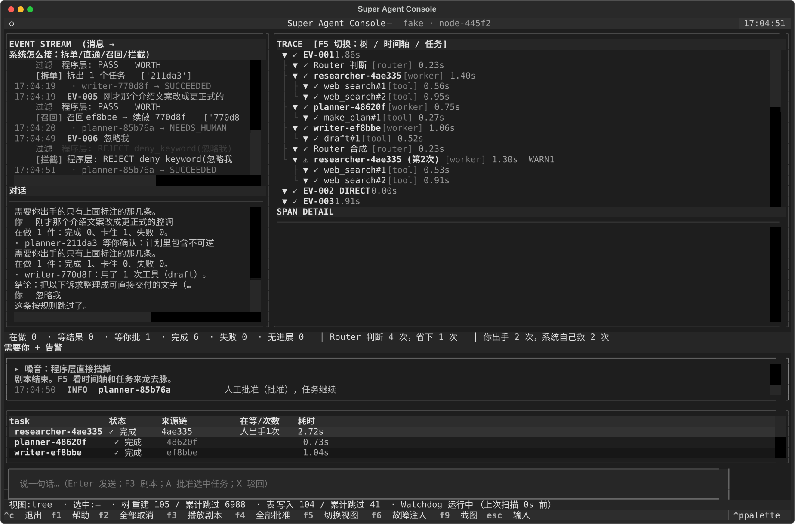

# mini_super_agent

**DeepSeek Harness（DSH）里 Super Agent 架构的一个 mini 复刻**：把「Router 常驻只分派、Worker 临时执行、任务状态外置」这套骨架单独实现出来，方便跑通、阅读和改。

不是 DSH 本身，也不是它的完整能力。DSH 是产品级的常驻 Agent 系统，这里只挑了主干：多会话管理、事件过滤、订阅直通、链式召回、挂起等人、外部巡检、以及配套的 trace 和日志。

AgentScope 2.0 + Textual，单进程，本地可跑。

```bash
pip install -r requirements.txt
python web.py            # 浏览器控制台 http://127.0.0.1:8080
python main.py           # 终端界面
```

首次使用先配模型（也可以启动后在网页右上角「设置模型」里填）：

```bash
python tools/setup_model.py --ping
```

Windows 下双击 `start_web.bat` 或 `start.bat`。两个界面共用同一个 `Runtime`，只是观察者不同。



---

## 实现了什么 / 没实现什么

从 DSH 的 Super Agent 里复刻下来的：

| 机制 | 这里的实现 |
| --- | --- |
| Router 与 Worker 分层 | Router 常驻、只出任务单不干活；Worker 临时拉起，跑完即弃 |
| 任务状态外置 | `TaskBrief` + `TaskTable`，状态机、订阅键、来源链、人工介入计数 |
| 事件过滤 | 程序层（确定性规则）先挡噪音，语义层只做标注，是否行动由 Router 判 |
| 订阅直通 | 主题命中在管任务就直接投递，不调 Router，省下的判断次数可见 |
| 链式召回 | 沿 `trace_chain` 找回旧任务，派生续做，把上一版产出当上下文交接 |
| 挂起与恢复 | 等外部结果（`WAITING`）与等人确认（`NEEDS_HUMAN`）都是非终态，不占执行体 |
| 外部 Watchdog | 独立巡检：疑似卡死、连续重复无进展；只标记和注入提示，从不 cancel |
| 取消 | 协作式，在安全点检查标记；`SUSPECT` 不被取消覆盖 |
| Trace | span 树 / 瀑布时间轴 / 任务生命周期，工具级记录参数与结果 |
| 可追溯 | 每次运行落 `logs/run-*`，`tools/inspect_log.py` 直接给定位结论 |

DSH 有、这里**没有**的（都是产品化才需要的东西）：

- 多渠道接入：只有控制台和浏览器，没有群聊、GitHub、CI 事件源
- 多副本调度：`owner_node` 只是语义占位，没有真正的跨进程分配
- 上下文容量管理：没做内联、溢写、压缩，Worker 上下文跑完即弃
- 成本控制：没有 token 预算和配额
- 权限体系：工具只有 ALLOW 桩，没有审批策略
- 沙箱执行：工具直接在本机跑
- 专用搜索后端：检索只有 `webfetch`，抓取质量取决于目标站点

---

## 它能做什么

配好模型后直接说人话：

| 你说 | 它怎么处理 |
| --- | --- |
| 帮我查个深圳的徒步计划 | 拆成任务，用 webfetch 抓真实页面，给路线、距离、爬升 |
| 写一份本周周报，三件事：… | 起一个 writer，写成文 |
| 介绍一下 Raft 和 Paxos 的区别 | 不开任务，直接回答 |
| 路线那条再补一句：避开收费景区 | 投递给正在办这件事的任务，不重新开 |
| 刚才那个文案改成正式腔调 | 找回那条任务，派生续做 |
| 帮我订下周三去成都的机票 | 涉及花钱，先停下来等你批准 |
| 忽略我 | 程序层拦掉，不调模型 |

它不把每次对话当成孤立的一问一答。任务表记着每件事做到哪了，所以补条件、找回旧事、挂起等人、取消，都作用在同一件事上。

---

## 配置

配置写到 `config.json`（已加进 .gitignore，不会进版本库）。

```json
{
  "model": {
    "provider": "huawei-maas",
    "base_url": "https://api.modelarts-maas.com/openai/v1",
    "api_key": "你的 Key",
    "model_name": "deepseek-v4.1-flash"
  }
}
```

| provider | base_url | 说明 |
| --- | --- | --- |
| `huawei-maas` | `https://api.modelarts-maas.com/openai/v1` | 华为云 MaaS，模型名如 `deepseek-v4.1-flash`、`qwen3-32b`、`openpangu-2.0-pro` |
| `deepseek` | `https://api.deepseek.com/v1` | DeepSeek 官方 |
| `openai` | `https://api.openai.com/v1` | OpenAI |
| `ollama` | `http://127.0.0.1:11434/v1` | 本地模型 |
| `fake` | — | 内置假模型，不联网，只用于测试和离线演示 |

优先级：命令行 > 环境变量 > `config.json` > 默认值。Key 也可以放 `MAAS_API_KEY` / `DEEPSEEK_API_KEY` / `OPENAI_API_KEY`。

---

## 检索只用 webfetch

`web_search` 要么真搜，要么报错，不编结果。

| 情况 | 行为 |
| --- | --- |
| 设了 `TAVILY_API_KEY` | 走 Tavily |
| 设了 `BOCHA_API_KEY` | 走博查 |
| 都没配 | 走内置 DuckDuckGo Lite，无需 Key |
| 假模型模式 | 报错「离线演示模式不联网」 |

`fetch_url` 真抓网页；`draft` / `make_plan` 由模型生成；`start_job` 是后台抓取（要传 URL）。

工具失败会作为错误回给模型，模型会告诉你「这个源没取到」，而不是编一份看着像真的摘要。

---

## 日志与问题定位

每次运行写一个目录 `logs/run-<时间>/`：

| 文件 | 内容 |
| --- | --- |
| `events.jsonl` | 每个 TraceEvent 一行，含 seq、时间戳、span/任务/告警 |
| `session.log` | 给人读的流水：输入、过滤判定、Router 决定、异常栈 |
| `summary.json` | 退出时的统计快照（崩溃也会尽量写） |

```bash
python tools/inspect_log.py            # 最近一次：输入去向 + 失败任务 + 慢步骤 + 异常
python tools/inspect_log.py --errors   # 只看异常栈
python tools/inspect_log.py --list     # 历史运行列表
```

日志只保留最近 20 次，`--no-log` 可以关掉。

---

## 它解决什么

单个任务的质量取决于模型，这部分没什么可做的。卡在人的是另一头：一个人同时能跟住的活跃会话大约三到五个，再多就得自己在会话之间搬运上下文、自己记着哪件事做到哪一步。

这个运行时把这几件事接了过去：

| 原先人要做的 | 现在由系统做 |
| --- | --- |
| 为每件新事开一个会话 | Router 把一条消息拆成 1–3 条任务，各自跑 |
| 把补充条件贴回对应会话 | 按主题直通给正在办那件事的 Worker |
| 翻旧对话找「刚才那个」 | 顺着任务链召回，派生成续做任务 |
| 盯每条通知判断要不要处理 | 程序层先筛、语义层再判；不可逆动作挂起等人 |

支撑上面这些的是同一件事：任务状态不放在调用栈里。Router 常驻只分派，Worker 临时拉起、跑完即弃，状态存在任务表里。状态离开调用栈之后，并行、追加要求、取消、重启后恢复才谈得上。

它不解决什么：不提升单任务质量，也不做跨用户协同。这是运行时的骨架，不是能力更强的 Agent。

---

## 一次演示

完整步骤和逐条输出见 [docs/DEMO.md](docs/DEMO.md)。六句话，每句对应一种处理：

| # | 你说 | 系统怎么处理 | 标记 |
| --- | --- | --- | --- |
| 1 | 帮我查一下成都周边徒步路线，排个两天计划，再写一版介绍文案 | Router 拆出三张任务单，三个 Worker 并行 | `[拆单]` |
| 2 | 路线那条再补一句：避开收费景区 | 投递给正在管「路线」的任务，不经过 Router | `[直通]` |
| 3 | 另外帮我订一张下周三去成都的机票，先看看航班和价格 | 拆出两张单；查航班那条先挂起等外部结果 | `[拆单]` |
| 4 | 排期里那步订票，帮我直接订了吧 | 含付费动作，挂起等人确认 | `[拆单]` |
| 5 | 刚才那个介绍文案改成更正式的腔调 | 找回第 1 句那条文案任务，派生续做 | `[召回]` |
| 6 | 忽略我 | 程序层拦截，不调用模型 | `[拦截]` |

走完后的状态行：

```
在做 0 · 等结果 0 · 等你批 1 · 完成 6 · 失败 0 · 无进展 0 │ Router 判断 4 次，省下 1 次 │ 你出手 2 次
```

状态行里的「省下 1 次」对应第 2 句，「等你批 1」对应第 4 句，可以直接核对。最后一项「系统自己救 N 次」统计 Watchdog 注入和作业完成后的自动恢复，这个数取决于作业什么时候返回，每次跑不一定相同。

界面上除了任务表和 Trace 树，左侧有一块**对话区**：你说的每句话和系统的回应都在那里。每条消息都会有回应，包括被过滤掉的（会说明为什么没处理）。

按 **F3** 自动播放剧本，**F5** 在三个视图之间切换。浏览器版把这些做成按钮和折叠面板，不用记键位。

---

## 机制

### 分派

Router 没有工具，只输出一个 JSON 判断，四选一：`direct` / `recall` / `spawn` / `ignore`，`spawn` 时附带任务单。判断依据是「在管的事」和「已结束的事」两个列表，由运行时从任务表实时生成。

Worker 按角色挂不同工具集：researcher 有搜索、抓取和挂起等待；planner 有计划、异步作业和人工确认；writer 有起草和抓取。全部是本地桩，返回确定性数据。

代码：`runtime.Router`、`runtime.WorkerPool.enqueue()`

### 直通

每条任务带一个 `topic` 作为订阅键。新消息进来先过程序层：主题命中在管任务就直接投递，不调用 Router。这条路径是确定性的，代价可控，省下的判断次数直接反映在状态行上。

投递时如果任务还在跑，追加进它的上下文；如果已经结束，拉回重跑一次，但仍然是同一条 task，不新建。

代码：`Runtime._find_subscriber()`、`WorkerPool.deliver()`

### 召回

`TaskBrief` 记录 `origin_task_id` 和完整的 `trace_chain`。遇到「刚才那个 XX」时，在已结束的任务里按主题和意图打分选目标，派生的新任务挂在它后面。

代码：`Runtime._pick_recall_target()`、`state.TaskBrief.trace_chain`

### 两个挂起状态

`WAITING` 等外部结果，`NEEDS_HUMAN` 等人确认。两者都满足：不是终态、不占执行体、不被 Watchdog 催。

不可逆动作（订票、下单、支付、删除、发消息）一律先停下来请示，不替用户决定。控制台里按 **A** 批准、**X** 驳回。

恢复路径不同：`WAITING` 由外部条件触发（Demo 里用定时循环模拟，真实场景是回调或轮询），`NEEDS_HUMAN` 只能人给。两者恢复后都是换一段新的执行继续，不是重跑整个任务。

代码：`WorkerPool.resume_waiting_all()`、`WorkerPool.approve()`

### Watchdog

独立于 Agent 之外的巡检 task，判断两件事：

- **长时间没有活动** → 疑似卡死
- **一直在调工具但同一个连续 N 次** → 无进展

第二种是真正有价值的：Agent 看起来在忙，实际上在原地打转。判定后它往 Worker 的上下文里注入一条提示（「你已经连续 4 次调用 web_search，基于已有信息收尾」），而不是直接 cancel。收不收尾由 Worker 在下一个安全点决定。

注入算系统替人做的干预，记在「系统自己救」上。它自己卡住时，状态行会显示「上次扫描 N 秒前」。

代码：`runtime.Watchdog`

---

## Trace

日志平铺对并发执行没有用：看不出哪条链在等谁、总耗时被谁决定。所以分成三个视图，各自回答一个问题。

**树**：谁拉起了谁。`EV-001 → Router 判断 → 各 Worker → 各自的工具`，节点上内联状态、耗时和告警徽标。

**时间轴**：为什么是这个耗时。横轴是时间，每个 Worker 一条泳道，工具调用画成色块。给出并发峰值、关键路径，以及「同时忙」对「串行需」的对比。

**任务来龙去脉**：每条任务一行，含来源链、订阅键、人出手和系统自愈次数。

时间轴的计算有两个容易出错的地方：

1. **挂起的时间不能算成在执行。** 早期版本里 `WAITING` 状态的 Worker span 一直不结束，于是等人批的 34 秒被算进执行时间，得出「并行省下 34 秒」的错误结论。现在挂起时立即结束该段 span，恢复时另起一段；时间轴上单独标 `░`，不计入「同时忙」。
2. **关键路径只取最晚结束的执行链**，不建完整依赖图。Demo 里 Worker 之间没有显式依赖，这样够用，也避免了假精确。

代码：`trace.build_timeline()`、`trace.timeline_lines()`、`trace.lifecycle_lines()`

---

## 代码结构

```
main.py          终端界面：面板布局、@work 入口、增量刷新、三视图
web.py           浏览器界面：同一个 Runtime，标准库 HTTP
ui/console.html  前端页面（时间轴 / 调用树 / 详情），改样式不用动 Python
ui/settings.html 模型设置页
runtime.py       EventGate / Router / WorkerPool / Watchdog / 假模型 / 工具
trace.py         Span / TraceStore / 时间轴 / 生命周期 / 增量渲染
state.py         TaskBrief / TaskTable：状态、订阅、任务链、人工介入记录
config.py        模型配置：预设、读写、Key 掩码
runlog.py        运行日志：events.jsonl / session.log / summary.json
prompts.py       Router 判断 / 合成 / 直接回答的 prompt
headless.py      不启动界面的冒烟
scenarios.py     剧本数据，三个入口共用
tools/inspect_log.py   读日志定位问题
tools/setup_model.py   交互式配置模型
start.bat / start_web.bat   Windows 一键启动
config.example.json        配置模板（真实的 config.json 不入库）
tests/           109 个测试
```

依赖方向单向：`trace.py` 不引 agentscope，`runtime.py` 不引 textual。运行时与界面之间只有一个 `asyncio.Queue`，界面是可替换的观察者。

界面刷新全部是增量的：Trace 树按节点指纹比对，任务表按行 key 稳定更新，日志只追加。终端版最底下一行实时显示「重建」和「累计跳过」的次数。

---

## 测试

```bash
python -m pytest        # 109 passed
python headless.py      # 两个场景跑通并断言
```

覆盖的重点是几条硬约束，而不是界面细节：

- Router 不挂工具，只产出任务单
- Worker 用 `asyncio.gather` 并行拉起，并发峰值可断言
- 直通不增加 Router 判断次数，且作用在同一条任务上
- 召回能在一堆已结束任务里选对目标
- 挂起后批准能继续跑，驳回能终止
- Watchdog 不覆盖取消标记，不催挂起的任务
- 时间轴不把等待时间算进并行收益
- Tree 和 DataTable 的增量更新：无变化时零重建

---

## 已知限制

原型只覆盖了架构主干，下面几项是上线前必须补的：

- **不接外部渠道**。事件只从控制台/浏览器输入，没有群聊、GitHub、CI 接入。
- **单进程**。`owner_node` 和重启重排只做到语义层面，没有真正的多副本调度。
- **没有上下文容量管理**。没做内联与溢写，Worker 的上下文跑完即弃。
- **没有成本控制**。token 消耗没有预算上限。
- **工具调用参数没入 trace**。AgentScope 的 `ToolCallStartEvent` 只带工具名和 call id，不带参数，所以详情里只能看到工具名、耗时和状态。
- **搜索是尽力而为**。内置的 DuckDuckGo Lite 靠解析 HTML，对方改版就会失效；要稳定就用 Tavily/博查。

---

## 键位

| 键 | 作用 |
| --- | --- |
| Enter | 发送 |
| F3 | 播放演示剧本 |
| F5 | 切换 树 / 时间轴 / 任务 |
| A / X | 批准 / 驳回选中任务 |
| F2 | 全部取消（协作式） |
| F1 | 帮助 |
